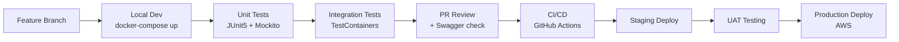

# 📋 ImEnglish Project — Tổng Hợp Phân Tích & Kế Hoạch

## 🔍 Đánh Giá Tài Liệu Gốc

> [!NOTE]
> Đã đọc file [MÔ TẢ ĐỀ TÀI DỰ ÁN.docx](file:///c:/Users/Dell/OneDrive/Documents/ImEnglish/MÔ TẢ ĐỀ TÀI DỰ ÁN.docx) — **Ý tưởng rất tốt, có Product-Market Fit thực sự.**

### ✅ Điểm Mạnh Giữ Nguyên
- Insight tâm lý **"Fear of Mistakes" + "Awkward Silence"** — đây là pain point thực sự
- Chuỗi 2 giai đoạn: **AI tự tin trước → P2P thực chiến** — logic học tập đúng
- Long-term Memory AI — tính năng differentiator cao
- Tech stack hướng đúng (Java Spring Boot + WebRTC + MongoDB)

### 🔧 Điều Chỉnh & Tối Ưu Đã Áp Dụng

| Lĩnh vực | Vấn đề gốc | Đã tối ưu |
|----------|------------|-----------|
| **Kiến trúc** | Nhắc Node.js signaling riêng | → Spring WebSocket đủ dùng, giảm complexity |
| **Database** | Không rõ phân chia dữ liệu | → Chiến lược dual-DB rõ ràng (PG + Mongo) |
| **Bảo mật** | Chỉ đề cập JWT | → Refresh token rotation, rate limiting, TURN auth |
| **AI Cost** | Không đề cập | → Chiến lược model tiering (GPT-4o vs GPT-4o-mini) |
| **WebRTC** | Chưa có TURN | → TURN server (Coturn) bắt buộc từ đầu |
| **Scalability** | Chưa đề cập | → Redis cho session, horizontal scaling ready |
| **Speech** | Chỉ Web Speech API | → Fallback Whisper API cho Safari/mobile |

---

## 📁 Cấu Trúc `.agents` Đã Tạo

```
c:\Users\Dell\OneDrive\Documents\ImEnglish\
├── .agents/
│   ├── rules/
│   │   └── GEMINI.md              ← Coding standards & architecture rules
│   ├── skills/
│   │   ├── java-springboot/       ← Spring Boot patterns & best practices
│   │   │   └── SKILL.md
│   │   ├── webrtc-websocket/      ← WebRTC signaling & P2P setup
│   │   │   └── SKILL.md
│   │   ├── genai-integration/     ← AI prompts & memory patterns
│   │   │   └── SKILL.md
│   │   ├── database-design/       ← PostgreSQL + MongoDB schemas
│   │   │   └── SKILL.md
│   │   ├── react-frontend/        ← React + Web Speech API patterns
│   │   │   └── SKILL.md
│   │   └── project-workflow/      ← Git, testing, CI/CD workflow
│   │       └── SKILL.md
│   └── mcp_config.json            ← MCP filesystem config
└── docs/
    ├── 01_Mo_Ta_Nghiep_Vu.docx   ← Business Requirements
    ├── 02_Use_Cases.docx          ← 20 use cases + detailed specs
    ├── 03_Database_Design.docx    ← Full DB schema (PG + Mongo)
    ├── 04_Tech_Stack_Architecture.docx  ← Kiến trúc & tech stack
    ├── 05_API_Design.docx         ← REST API + WebSocket endpoints
    └── 06_Project_Plan.docx       ← Sprint plan + Risk matrix
```

---

## 📄 Tài Liệu Đã Tạo (6 files .docx)

````carousel
### 📄 01 — Mô Tả Nghiệp Vụ
**File:** [01_Mo_Ta_Nghiep_Vu.docx](file:///c:/Users/Dell/OneDrive/Documents/ImEnglish/docs/01_Mo_Ta_Nghiep_Vu.docx)

**Nội dung:**
- Bối cảnh & vấn đề (2 rào cản tâm lý)
- Mục tiêu & hành trình 2 giai đoạn
- Đối tượng người dùng (4 nhóm)
- Chi tiết 2 Module: AI Companion + P2P
- Quy trình nghiệp vụ chính (3 luồng)
- Yêu cầu phi chức năng (performance, security, scalability)

<!-- slide -->
### 📄 02 — Use Cases
**File:** [02_Use_Cases.docx](file:///c:/Users/Dell/OneDrive/Documents/ImEnglish/docs/02_Use_Cases.docx)

**Nội dung:**
- 4 Actors (Guest, Learner, AI System, Admin)
- **20 Use Cases** đầy đủ (UC01 → UC20)
- Đặc tả chi tiết UC08 (AI Roleplay) + UC13 (P2P Voice)
- Pre-conditions, Main flow, Alternative flow, Post-conditions, Exceptions

<!-- slide -->
### 📄 03 — Database Design
**File:** [03_Database_Design.docx](file:///c:/Users/Dell/OneDrive/Documents/ImEnglish/docs/03_Database_Design.docx)

**Nội dung:**
- Chiến lược phân chia PostgreSQL vs MongoDB
- **6 bảng PostgreSQL:** users, refresh_tokens, friendships, p2p_sessions, ai_sessions, user_stats
- **5 collections MongoDB:** conversations, ai_memories, scenarios, icebreaker_cards, feedback_reports
- Indexing strategy cho cả hai database

<!-- slide -->
### 📄 04 — Tech Stack & Architecture
**File:** [04_Tech_Stack_Architecture.docx](file:///c:/Users/Dell/OneDrive/Documents/ImEnglish/docs/04_Tech_Stack_Architecture.docx)

**Nội dung:**
- Sơ đồ luồng dữ liệu tổng thể
- **Backend:** Java 21 + Spring Boot 3.3.x (14 dependencies)
- **Database:** PostgreSQL 16 + MongoDB 7 + Redis 7
- **Real-time:** Spring WebSocket + WebRTC + Coturn TURN
- **AI:** Gemini + GPT-4o + Whisper (chiến lược tiering)
- **Frontend:** React 18 + TypeScript (14 libs)
- **Infrastructure:** Docker + AWS + GitHub Actions
- **Security:** 10 lĩnh vực bảo mật

<!-- slide -->
### 📄 05 — API Design
**File:** [05_API_Design.docx](file:///c:/Users/Dell/OneDrive/Documents/ImEnglish/docs/05_API_Design.docx)

**Nội dung:**
- Quy tắc chung (base URL, auth, format)
- **Auth APIs** (8 endpoints)
- **User APIs** (6 endpoints)
- **AI Companion APIs** (9 endpoints)
- **P2P APIs** (7 endpoints)
- **Social APIs** (8 endpoints)
- **WebSocket Endpoints** (6 channels STOMP)

<!-- slide -->
### 📄 06 — Project Plan
**File:** [06_Project_Plan.docx](file:///c:/Users/Dell/OneDrive/Documents/ImEnglish/docs/06_Project_Plan.docx)

**Nội dung:**
- Work Breakdown Structure (WBS) — 6 phases
- **Phase 0:** Setup (2 tuần)
- **Phase 1:** AI Companion MVP (4 tuần)
- **Phase 2:** P2P Connection (3 tuần)
- **Phase 3:** Social Features (2 tuần)
- **Phase 4:** Dashboard & Polish (2 tuần)
- **Phase 5:** Launch Prep (1 tuần)
- Risk matrix (6 rủi ro chính + biện pháp)
````

---

## 🔧 Skills AI Đã Cài Đặt

| Skill | Kích hoạt khi |
|-------|--------------|
| `java-springboot` | Viết code Spring Boot, Controller, Service, Entity |
| `webrtc-websocket` | Làm việc với P2P call, signaling, STOMP |
| `genai-integration` | Tích hợp AI, tạo prompts, memory system |
| `database-design` | Thiết kế schema, viết migrations |
| `react-frontend` | Viết React components, Web Speech API |
| `project-workflow` | Git flow, testing, deployment |

---

## 🗺️ Workflow Phát Triển



---

## ⚡ Bước Tiếp Theo Khuyến Nghị

> [!IMPORTANT]
> Thứ tự ưu tiên triển khai:

1. **Ngay bây giờ:** Khởi tạo Spring Boot project với `spring initializr`
2. **Tuần 1-2:** Docker Compose + DB migrations + JWT auth flow
3. **Tuần 3-6:** AI Companion (core feature — differentiator chính)
4. **Tuần 7-9:** P2P WebRTC (test kỹ với TURN server)
5. **Tuần 10+:** Social, Dashboard, Launch

> [!TIP]
> Dùng lệnh `/goal` để chạy task dài hơi, hoặc hỏi tôi để bắt đầu khởi tạo cấu trúc code Spring Boot project!
